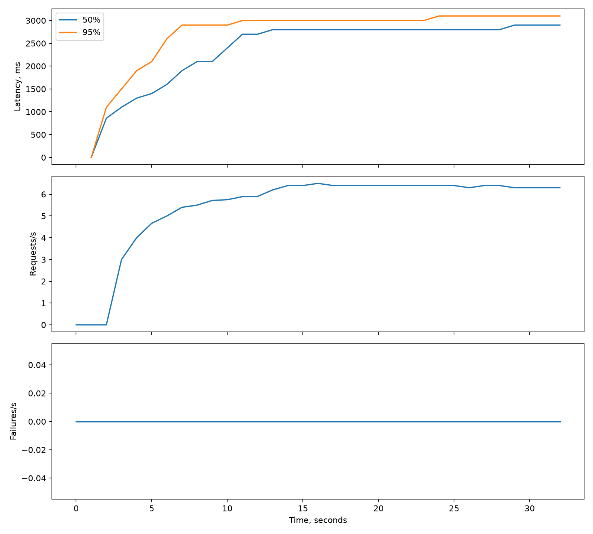
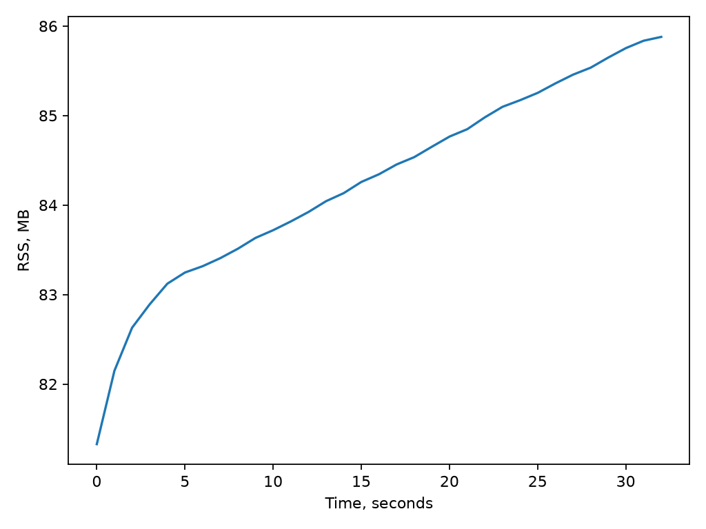

# Локальные измерения AsyncPulse

Дата: 14 октября 2026 года. Python 3.12.13, FastAPI 0.143.1, httpx 0.28.1, Locust 2.46.7. Запуск на локальной машине, один Uvicorn worker, десять mock источников по 500 мс, кеш отключён. Конфигурация планировщика по умолчанию. Это демонстрационные измерения, не гарантии производительности.

## Последовательный и конкурентный поиск

По пять успешных поисков на режим без кеша:

| Режим | Медиана |
| --- | ---: |
| Последовательный | 5022,47 мс |
| Конкурентный | 509,53 мс |

Ускорение: 9,86 раза. Сырые значения: [benchmark.json](reports/benchmark.json). Замер берёт `elapsed_ms` сервера, начиная с момента запуска поиска worker; ожидание в очереди и HTTP путь клиента сюда не входят.

## Нагрузка

20 пользователей, рост по пять пользователей в секунду, 30 секунд генерации нагрузки плюс завершение активных запросов. Пауза между запросами 100–500 мс. Уникальные поисковые строки исключают coalescing. Кеш отключён.

| Показатель | CSV-снимок |
| --- | ---: |
| Завершённые запросы | 200 |
| Ошибки | 0 |
| Throughput | 6,30 поисков/с |
| p50 | 2800 мс |
| p95 | 3000 мс |
| Максимум | 3100,97 мс |
| RSS процесса API | 81,33–85,88 МБ |

Показатели взяты из последнего сохранённого CSV-снимка Locust. Финальный вывод в терминале содержал 203 запроса и ноль ошибок: последние три завершились после записи CSV. Процентили Locust приближённые. Нагрузочная latency измеряется клиентом и включает очередь. Рост задержки относительно одиночного поиска объясняется глобальным ограничением 32 внешних HTTP запросов при десяти источниках на каждый поиск.

Сырые файлы: [статистика](reports/load_stats.csv), [история](reports/load_stats_history.csv), [RSS](reports/memory.csv). Память измеряется только для процесса API, без mock сервера и генератора нагрузки. Короткий тест не доказывает отсутствие утечек при длительной работе. Docker-сборка выполнялась параллельно с частью нагрузки, что также могло влиять на результаты.

## Проверка полного стека

Docker Compose успешно собран и запущен. HTTP поиск вернул десять успешных результатов; повторный поиск получил все десять из Redis-кеша. В Redis подтверждены десять ключей, в PostgreSQL — две записи `search_history`. Проверочные контейнеры после проверки остановлены.

11 автоматических тестов проверяют конкурентность, кеш, coalescing при отмене одного клиента, освобождение слотов при уходе последнего клиента, 429/retry, таймаут, адаптацию gate, очередь, общий HTTP лимит, WebSocket, файловый экспорт и CPU обработку. `ruff check` и `ruff format --check` проходят.

Для повторения: команды из README или `uv run python scripts/run_experiment.py`. Новые артефакты появляются в `artifacts/`, сохранённый отчёт в `reports/` остаётся снимком этого запуска.
